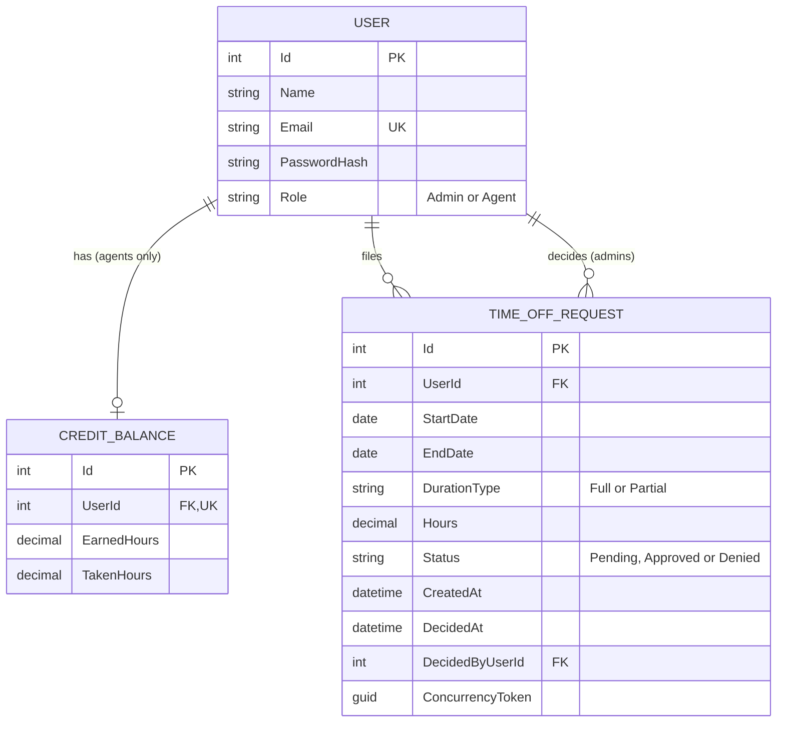

# Time Off Accrual

A Time-Off & Accrual module for a Workforce Management system.

## Tech stack
React (Vite) + ASP.NET Core Web API (.NET 8) + EF Core + SQLite

## How to run

### Prerequisites
- .NET 8 SDK
- Node.js 18 or newer

### 1. Backend
```bash
cd backend/TimeOffAccrual/TimeOffAccrual.Api
dotnet user-secrets set "Jwt:Key" "replace-with-any-random-string-of-32-or-more-characters"
dotnet run --launch-profile https
```

The JWT signing key is a secret, so it is not stored in the repo. The command above stores it on your machine. The app refuses to start without it.

On first start, the app creates the SQLite database (`timeoffaccrual.db`), applies the migrations, and seeds demo data. 

If the browser warns about the HTTPS certificate, run `dotnet dev-certs https --trust` once.

Swagger is at `/swagger` in the Dev environment.

### 2. Frontend
In a second terminal:
```bash
cd frontend
npm install
npm run dev
```
Open http://localhost:5173.

The frontend calls the API at `https://localhost:7123` by default. If your API runs on a different port, create `frontend/.env.local` with `VITE_API_URL=<your API address>` and restart `npm run dev`.

### Demo accounts (demo only, not for production)
All accounts use the password `Temp#12345`.

| Email | Role | Earned | Taken |
|---|---|---|---|
| admin@sample.com | Admin | n/a | n/a |
| agent1@sample.com | Agent | 80 | 16 |
| agent2@sample.com | Agent | 120 | 0 |
| agent3@sample.com | Agent | 8 | 0 |

### Reset the data
Stop the API, delete `timeoffaccrual.db` (and any `-shm` or `-wal` files), and start it again. The database is rebuilt and reseeded.

## Assumptions
- Requests can span a date range. Full Day counts as 8 hours per calendar day in the range.
- Partial Day requests are limited to a single date, with 0 < hours <= 8.
- Weekends and holidays are counted as regular days (simplification).
- Pending requests do not reserve balance. The balance is re-checked at approval time.
- Requests with a start date in the past are rejected.
- Authentication is simplified: the UI sends the selected user's ID, and the API enforces Admin/Agent roles on each endpoint.
- Available balance is calculated as Earned - Taken and is never stored.

## Schema overview



### Design notes
- **Available balance is computed** (`EarnedHours - TakenHours`) and never stored, so it can't drift out of sync.
- **One balance per agent**, enforced by a unique index on `CreditBalance.UserId`. Admins have no balance.
- **Enums are stored as text** (`Admin`, `Pending`) so the database is readable.
- **Check constraint** on requests: `EndDate >= StartDate`.
- **Indexes:** `(UserId, StartDate, EndDate)` for the overlap query and `Status` for the approval queue.
- **Concurrency:** a `Guid ConcurrencyToken` changes on every update, so two simultaneous approvals can't both succeed (SQLite has no auto `rowversion`).
- **SQLite and decimals:** SQLite stores `decimal` as text, so balance comparisons are done in C#, not in SQL or a check constraint.
- **Deletes are restricted**, so removing a user can't silently delete their history.

## Tradeoffs and next steps

### Design tradeoffs
- **Pending requests do not reserve balance.** The spec deducts credits only on approval. The balance is re-checked at approval time, so an agent can file several pending requests, but approval rejects any that no longer fit. Reserving hours on submit would be stricter but needs extra tracking.
- **SQLite for zero-setup.** Reviewers can clone and run. The schema lives in migrations and the data in a seeder. A production system would use PostgreSQL or SQL Server.
- **Balance math in C#.** SQLite stores decimals as text, so comparisons are done in application code rather than SQL or check constraints.
- **Calendar days only.** Weekends and holidays count as normal days to cater different shifts and schedules.
- **Dates use UTC.** "Today" is calculated in UTC, which can differ from a user's local date by a few hours.
- **Tokens in sessionStorage.** Simple, and cleared when the tab closes, but readable by injected scripts. React's default escaping is the mitigation. httpOnly cookies with CSRF protection would be stronger.

### Known limitations
- The concurrency token protects the request row, not the balance row. Two admins approving two different requests for the same agent at the same instant could both pass the balance check. A token on `CreditBalance` would close this gap.
- Automated tests are started (an xUnit project with an in-memory database) but not complete. Testing so far was manual, through the UI and Swagger only.

### Next steps
- Complete the automated tests and add CI (build and test on every push)
- Audit trail for credit adjustments (who changed what, and when)
- Agents can cancel their own pending requests
- Weekend and holiday calendars
- Pagination for the tables
- Refresh tokens and httpOnly cookies
- Login rate limiting and a global error handler